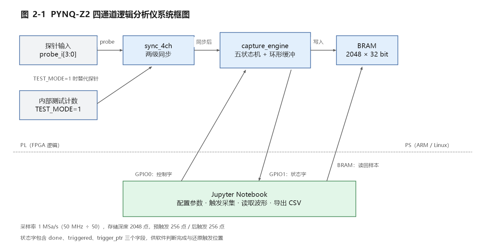
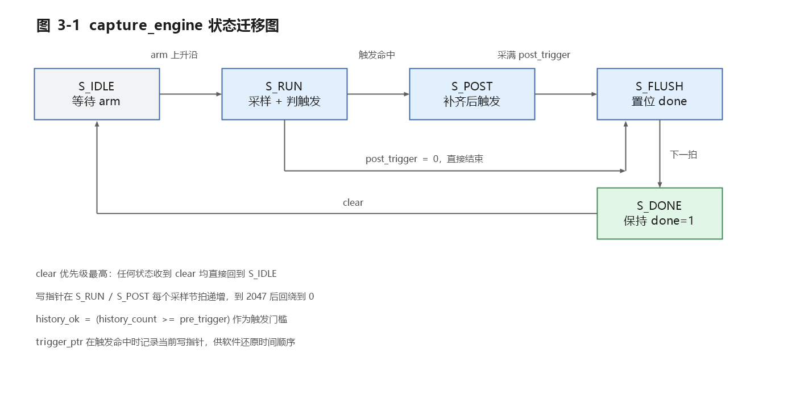
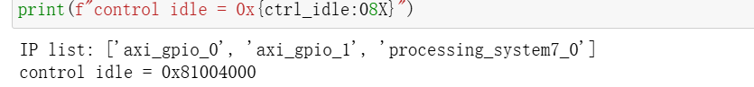
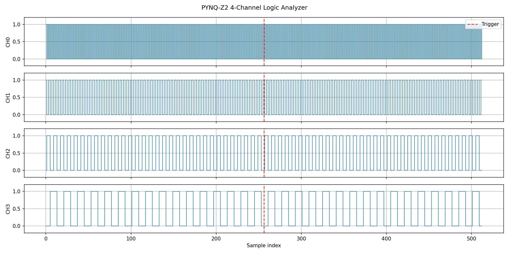
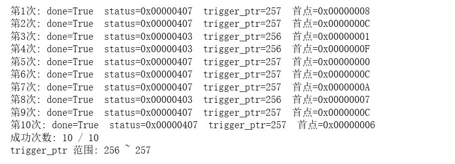

# PYNQ-Z2 四通道逻辑分析仪设计报告（初稿）

> 版本：v0.1（初稿）　日期：2026-10-19　编写：田若溪（队友B）
> 数据来源：仓库 main 分支的实现、报告文件与板级测试记录（team/evidence）

---

## 摘要

本项目在 PYNQ-Z2 开发板上实现了一台四通道数字逻辑分析仪。采集通路位于 PL（可编程逻辑）侧：四路探针经两级同步后，由采样分频器产生 1 MSa/s 的采样节拍，采集引擎按环形缓冲方式写入 2048 个采样点，并在命中触发条件后继续采集后触发数据，最后通过 `done` 标志通知软件。控制与显示位于 PS（ARM 处理器）侧：Jupyter Notebook 通过 AXI GPIO 下发控制字、轮询状态字、经 AXI BRAM Controller 读回采样数据，完成时间顺序还原、四通道波形绘制与 CSV 导出。

设计指标为：4 通道、采样率 1 MSa/s（50 MHz ÷ 50）、存储深度 2048 点、预触发 256 点、后触发 256 点、支持上升沿 / 下降沿 / 任意边沿三种触发方式、提供内部测试模式作为演示激励。实现结果：时序约束全部满足（最差建立余量 10.552 ns），LUT 占用 3.55%、寄存器占用 2.49%、占用 2 块 Block RAM，DRC 检查通过且完成全布线；板级验证中 Overlay 加载正常，单次采集 `done=1`、`triggered=1`、`trigger_ptr=256`，有效样本 513 点，CSV 导出 513 行 6 列，连续 10 次采集全部通过。

---

## 1 项目背景与目标

### 1.1 背景

调试数字电路时，仅靠示波器难以同时观察多路信号之间的时序关系。逻辑分析仪能够按固定采样率同时记录多路数字电平，并在触发条件命中时定格波形，是数字系统调试的基础工具。商用逻辑分析仪价格较高，而 FPGA 平台天然具备高速并行采样能力，适合自行实现一台满足课程与竞赛需求的小型逻辑分析仪。

### 1.2 设计目标

本项目的目标是：在 PYNQ-Z2（Zynq-7020）上以 PL 实现采集硬件、以 PS 实现上位机交互，形成一套可演示、可复现的四通道逻辑分析仪。

具体指标如下：

| 项目 | 指标 |
|---|---|
| 通道数 | 4 路数字输入（Pmod A：Y18 / Y19 / Y16 / Y17） |
| 采样率 | 1 MSa/s（50 MHz 系统时钟 ÷ 50） |
| 存储深度 | 2048 点（环形缓冲） |
| 触发位置 | 预触发 256 点、后触发 256 点 |
| 触发方式 | 上升沿、下降沿、任意边沿 |
| 触发通道 | CH0~CH3 任选 |
| 演示激励 | 内部测试模式（TEST_MODE=1），Pmod 外部输入非必做项 |
| 上位机 | Jupyter Notebook：配置、采集、波形显示、CSV 导出 |

### 1.3 范围界定

为避免范围蔓延，本项目明确不做：100 MHz 采样、Pmod 外部传感器与摄像头的完整验证、HDMI 显示、DDR 大容量缓存与 DMA、UART 协议解码。以上内容作为后续改进方向在第八章讨论。

---

## 2 系统总体架构

### 2.1 软硬件划分

系统由 PL 侧采集通路和 PS 侧控制显示两部分组成。

PL 侧负责实时性要求高的部分：探针同步、采样节拍产生、环形缓冲写入、触发判定与完成标志。PS 侧负责不要求实时性的部分：参数配置、状态轮询、数据读回、波形绘制、文件导出。两者通过 AXI 总线连接：控制字与状态字走 AXI GPIO，采样数据走 AXI BRAM Controller。



### 2.2 地址映射

| 外设 | 基地址 | 大小 | 用途 |
|---|---|---|---|
| axi_bram_ctrl_0 | 0x40000000 | 8 KB（2048 × 4 字节） | 采样数据 |
| axi_gpio_0 | 0x41200000 | 64 KB | 控制字输出 |
| axi_gpio_1 | 0x41210000 | 64 KB | 状态字输入 |

采用 AXI BRAM Controller 的原因是：它把 BRAM 映射为 PS 可直接读写的一段内存，软件无需自己实现访问时序；同时 BRAM 为真双端口，A 口接 AXI、B 口接采集逻辑，两侧互不阻塞。

### 2.3 数据流

一次完整采集的数据流为：探针电平（或内部测试计数）→ 两级同步 → 采样节拍控制下打包为 32 位字 `{28 位时间戳, 4 位探针}` → 写入 BRAM → 触发后由 PS 读回 → 按 `trigger_ptr` 还原时间顺序 → 四通道阶梯波形与 CSV。

---

## 3 硬件设计

### 3.1 顶层模块 logic_analyzer_top

顶层完成三件事：解析控制字、选择激励源、组装状态字与 BRAM 地址。

控制字 `ctrl` 来自 AXI GPIO 0 的 channel1，各位域定义如下：

**表 3-1 控制字位域**

| 位段 | 名称 | 含义 |
|---|---|---|
| ctrl[0] | arm | 上升沿启动一次采集 |
| ctrl[1] | clear | 复位状态机与所有指针，优先级高于 arm |
| ctrl[3:2] | trigger_ch | 触发通道，0~3 对应 CH0~CH3 |
| ctrl[5:4] | trigger_mode | 0 上升沿、1 下降沿、2 任意边沿 |
| ctrl[15:6] | post_trigger | 后触发采样点数，上限 1023 |
| ctrl[25:16] | pre_trigger | 预触发采样点数，上限 1023 |
| ctrl[31] | test_mode | 1 使用内部测试计数，0 使用 Pmod 输入 |

状态字 `status` 回读给 AXI GPIO 1：

**表 3-2 状态字位域**

| 位段 | 名称 | 含义 |
|---|---|---|
| status[0] | done | 采集完成标志，粘滞到 clear 为止 |
| status[1] | triggered | 本次采集是否命中触发条件 |
| status[12:2] | trigger_ptr | 触发点在环形缓冲中的地址 |

当 `test_mode=1` 时，探针输入取 4 位内部计数器，该计数器每个采样节拍自增，因此在四通道上呈现频率依次减半的方波，便于在无外部信号时验证整条链路。BRAM 使用字节地址模式，顶层把 11 位样本地址左移 2 位，使每个样本占满一个 32 位字。

### 3.2 同步模块 sync_4ch

外部探针信号与系统时钟异步，直接采样会引入亚稳态。`sync_4ch` 用两级触发器把四路输入逐级打拍，寄存器标记 `ASYNC_REG = "TRUE"` 以便综合工具正确布局，第三级输出供采集引擎使用。该模块结构简单，但它是保证采样数据可靠性的第一道防线。

### 3.3 采样分频模块 sample_divider

模块参数化为 `CLK_HZ = 50_000_000`、`SAMPLE_HZ = 1_000_000`，分频系数为 50。计数器计满后输出一个单周期脉冲 `sample_tick`，采集引擎只在该脉冲有效时写入样本，因此采样率严格等于 1 MSa/s。

### 3.4 采集引擎 capture_engine

采集引擎是本项目的核心，参数 `ADDR_WIDTH = 11`、`DEPTH = 2048`，由五个状态构成：

**表 3-3 状态机**

| 状态 | 跳出条件 | 行为 |
|---|---|---|
| S_IDLE | 检测到 arm 上升沿 | 清空写指针、计数器与时间戳 |
| S_RUN | 命中触发事件 | 每个采样节拍写一个样本；未攒够 pre_trigger 前不判触发 |
| S_POST | 采满 post_trigger 个点 | 继续写入触发之后的数据 |
| S_FLUSH | 下一拍自动跳转 | 置位 done |
| S_DONE | 收到 clear | 保持 done=1，等待软件读取 |

**环形缓冲。** 写指针从 0 递增到 2047 后回绕，因此缓冲中始终保留最近 2048 个样本。由于触发点可能落在环中任意位置，模块额外输出 `trigger_ptr` 记录触发时的写指针；软件据此做循环移位，即可还原出「触发前 256 点 + 触发点 + 触发后 256 点」的正确时间顺序。

**触发判定。** 先从同步后的四路信号中按 `trigger_ch` 选出被观察通道，与上一拍采样值比较得到上升沿、下降沿与任意边沿三种边沿信号，再由 `trigger_mode` 选择其中一种。此外设置 `history_ok`（历史计数不小于 pre_trigger）作为触发门槛，保证触发点之前确实攒够了预触发数据。

**数据打包与时间戳。** 每个样本在 BRAM 中占一个 32 位字，低 4 位为四通道电平，高 28 位为该样本的时间戳。1 MSa/s 下 28 位时间戳约 268 秒回绕一次，单次采集远小于该长度，不会产生歧义。

**done 标志。** `done` 设计为粘滞标志：软件读数据耗时不确定，粘滞可以保证任意时刻查询都不会漏掉完成事件，只有写完 clear 才清零。



---

## 4 软件设计

### 4.1 Notebook 流程

上位机以 Jupyter Notebook 实现，按七个步骤执行，每个步骤输出带编号的状态信息，便于演示与排错：

| 步骤 | 内容 | 成功标志 |
|---|---|---|
| 1/7 | 检查 bit/hwh 并加载 Overlay | IP 列表打印成功 |
| 2/7 | 配置参数并组装控制字 | ctrl_idle = 0x81004000 |
| 3/7 | clear → arm → 轮询 done | done=1 triggered=1 trigger_ptr=256 |
| 4/7 | 读 BRAM 并按 trigger_ptr 还原 | valid samples=513 |
| 5/7 | 绘制四通道波形 | 保存 waveform_4ch.png |
| 6/7 | 导出 CSV 并清零状态 | 513 行 × 6 列 |
| 7/7 | 连续 10 次采集 | PASS 10/10 |

### 4.2 控制时序

一次采集的控制序列为：写 `ctrl | 0x2` 产生 clear 脉冲把状态机复位；写 `ctrl` 归位；写 `ctrl | 0x1` 产生 arm 上升沿启动采集；写 `ctrl` 归位后进入轮询。软件不依赖固定延时判断完成，而是循环读取 `status`，直到 `status[0]` 置位或超时。

### 4.3 数据还原

读回 2048 个 32 位字后，按低 4 位拆出四通道电平，按高位拆出时间戳。设触发点地址为 `trigger_ptr`、预触发点数为 `PRE_TRIGGER`，则时间顺序的起点为：

```
start = (trigger_ptr - PRE_TRIGGER) % DEPTH
```

对数组做 `np.roll(arr, -start)` 后取前 `PRE_TRIGGER + POST_TRIGGER + 1 = 513` 个点，即为一次完整的触发窗口。

### 4.4 兼容性处理

本板卡的 PYNQ 版本要求 `AxiGPIO.Channel.write(value, mask)` 必须显式给出掩码，单参数写法会抛 `TypeError`。Notebook 中封装了 `write_ctrl()`：先尝试带 `0xFFFFFFFF` 掩码的调用，若当前版本只接受单参数则回退。这样同一份 Notebook 在新旧 PYNQ 上都能运行。

### 4.5 输出

波形图保存为 `waveform_4ch.png`，数据保存为 `logic_capture.csv`，列依次为 `index, timestamp, ch0, ch1, ch2, ch3`，共 513 行数据。

---

## 5 验证与测试

### 5.1 仿真验证

测试平台 `tb/logic_analyzer_tb.v` 复位后下发 clear，再给 arm，随后在 CH0 上制造上升沿，等待若干周期后检查 `status[0]` 是否置位，最后再发一次 clear 检查是否清零。仿真打印两条通过信息：

```
PASS: done=1, trigger_ptr=...
PASS: clear returned FSM to IDLE
```

需要说明的是：测试平台采用 10 ns 周期（100 MHz）时钟，而 `sample_divider` 的 `CLK_HZ` 按 50 MHz 填写，因此仿真中的采样间隔对应 2 MSa/s。该差异不影响功能验证，但报告中不应把仿真结果表述为「验证了 1 MSa/s」。

### 5.2 时序与资源

实现结果如下（Vivado 2026.1，器件 xc7z020clg400-1）：

**表 5-1 时序结果**

| 检查项 | 结果 |
|---|---|
| 建立时间最差余量 WNS | 10.552 ns |
| 保持时间最差余量 WHS | 0.038 ns |
| 脉宽最差余量 WPWS | 9.020 ns |
| 约束满足情况 | All user specified timing constraints are met |

**表 5-2 资源占用**

| 资源 | 使用量 | 占比 |
|---|---|---|
| Slice LUTs | 1891 | 3.55% |
| Slice Registers | 2648 | 2.49% |
| Block RAM Tile | 2 | 1.43% |
| DSP | 0 | 0% |
| BUFGCTRL | 1 | 3.13% |

DRC 检查无未处理违规，设计状态为 Fully Routed。

### 5.3 板级验证

板级测试记录（`team/test_record_template.csv`）如下：

**表 5-3 测试结果汇总**

| 编号 | 测试内容 | 结果 | 执行人 |
|---|---|---|---|
| TBD-002 | Overlay 加载 | 加载成功，done=1 triggered=1 trigger_ptr=256 | 队长 |
| TBD-003 | Notebook 采集与 CSV | 四通道方波正常，CSV 513 行 6 列 | 队长 |
| TBD-005 | 连续 10 次采集 | 10 次全部 done=1，无超时 | 队长 |
| TBD-007 | 重建 bit 加载 | 加载成功，control idle=0x81004000 | 队长 |
| TBD-008 | 重建 bit 采集 | 有效样本 513，CSV 已导出 | 队长 |
| TBD-009 | 重建 bit 连续 10 次 | 10 次全部 done=1 | 队长 |
| TBD-010 | 队友B 独立复跑 | Overlay 成功；done=1 triggered=1 trigger_ptr=256；valid=513；CSV 513×6；连续 10 次 PASS 10/10 | 队友B |
| TBD-011 | 上升沿触发（仿真） | 低电平不触发，0→1 后 triggered=1，3 项断言通过 | 队友A |
| TBD-012 | 下降沿触发（仿真） | 上升沿不误触发，1→0 后 triggered=1，3 项断言通过 | 队友A |
| TBD-013 | 任意边沿触发（仿真） | 上升沿与下降沿均触发，稳定电平不触发，3 项断言通过 | 队友A |
| TBD-014 | 预/后触发组合（仿真） | 0/0、1/0、0/1、8/4 四组均正确，13 项断言通过 | 队友A |
| TBD-015 | 环形缓冲回绕（仿真） | 写地址 8188→0 回绕，回绕后仍能触发，7 项断言通过 | 队友A |
| TBD-016 | 采集中 clear（仿真） | 状态回 IDLE，done/triggered/wr_ptr 清零，可重新 arm，8 项断言通过 | 队友A |
| TBD-017 | 发布候选 bit/hwh smoke test | Overlay 成功；done=1 triggered=1 trigger_ptr=257；valid=513；连续 10 次通过 | 队长 |
| TBD-018 | Tcl 独立干净重建 | WNS=10.552、LUT=1891、FF=2648、BRAM=2，与队长构建一致 | 队友A |

TBD-010 使用 main 分支提交的 bit 与 hwh，在 PYNQ-Z2 上独立完成，证据见 `team/evidence/2026-10-19/`（Overlay 截图、四通道波形、CSV、连续 10 次输出）。

TBD-011~TBD-016 覆盖三种触发模式、预/后触发组合、环形缓冲回绕与采集中 clear 的仿真边界测试，均在 Vivado 2026.1 XSim 下通过；TBD-017 对发布候选 bit/hwh 做了板级 smoke test；TBD-018 由队友A 在自己的环境中用 Tcl 从全新目录独立重建，时序与资源结果与队长构建一致，验证了工程的可持续复现性。







### 5.4 测试结论

范围内各项均通过：Overlay 加载、单次采集、四通道波形、CSV 导出、连续 10 次稳定性。Pmod 外部输入未做完整验证，属于范围外内容。

---

## 6 问题与改进

**采样率固定。** 目前分频比写死为 50，可通过把分频系数做成运行时可配置的寄存器，实现 1 / 2 / 5 MSa/s 等多档采样率。

**存储深度受限。** 2048 点受单块 BRAM 容量限制，后续可扩展多块 BRAM，或引入 DDR 缓存与 DMA 以支持长时采集。

**时间戳回绕。** 28 位时间戳在 1 MSa/s 下约 268 秒回绕，长时间连续采集需要扩位或分段记录。

**外部输入未验证。** Pmod 通道的电气特性与输入保护尚未测试，正式演示依赖内部测试模式。

**旧版 Notebook 兼容性。** v1 使用单参数 GPIO 写入，在部分 PYNQ 版本上会报 `TypeError`；v2 已统一改为兼容写法，后续应避免同一功能存在两份不一致的实现。

**操作流程依赖手工上传。** bit、hwh 与 Notebook 需要手动上传到板卡同一目录，后续可用脚本或 PYNQ 部署流程自动化。

---

## 7 团队分工

| 成员 | 负责内容 |
|---|---|
| 队长 | 仓库与流程管理、代码审查、顶层与重建脚本、板级验证、范围冻结 |
| 队友A | 测试计划、Testbench 仿真、边界测试 |
| 队友B | 文档（使用说明、术语表、报告与 PPT）、Notebook 复跑与优化、证据归档 |

---

## 8 结论

本项目在 PYNQ-Z2 上完成了一台四通道、1 MSa/s、2048 点深度、支持三种边沿触发的逻辑分析仪。PL 侧实现了可靠的异步同步、精确的采样节拍、带触发定位的环形缓冲与完成握手；PS 侧通过 Notebook 完成了参数配置、数据回读、时序还原、波形显示与数据导出。时序与资源报告满足约束，板级测试覆盖单次采集、连续采集与重建比特流验证，结果稳定可复现。

系统的不足集中在采样率与深度的可配置性、外部输入的验证，以及软件部署的自动化程度，这些已在第八章列出改进方向。

---

## 附录 A 术语表

见 `docs/glossary.md`。

## 附录 B 复现步骤

1. 将 `pynq/logic_analyzer.bit` 与 `pynq/logic_analyzer.hwh` 上传到板卡同一目录，保持基名一致。
2. 上传 `notebooks/logic_analyzer_v2.ipynb` 到同一目录。
3. 浏览器访问 `http://192.168.2.99:9090`，登录用户名与密码均为 `xilinx`。
4. 依次运行 Notebook 的 7 个步骤，确认末尾输出「全部 7 个步骤完成」。

## 附录 C 证据索引

| 内容 | 位置 |
|---|---|
| TBD-010 复跑证据 | `team/evidence/2026-10-19/` |
| Notebook v2 证据 | `team/evidence/2026-10-19/T010_notebook_v2_*` |
| 时序报告 | `reports/timing_summary.rpt` |
| 资源报告 | `reports/utilization.rpt` |
| DRC 报告 | `reports/drc.rpt` |

---

*初稿说明：图 2-1、图 3-1 已生成在 figs/ 目录，第五章引用了 team/evidence/2026-10-19/ 下的实测截图；第六章可按答辩需要增删条目。*